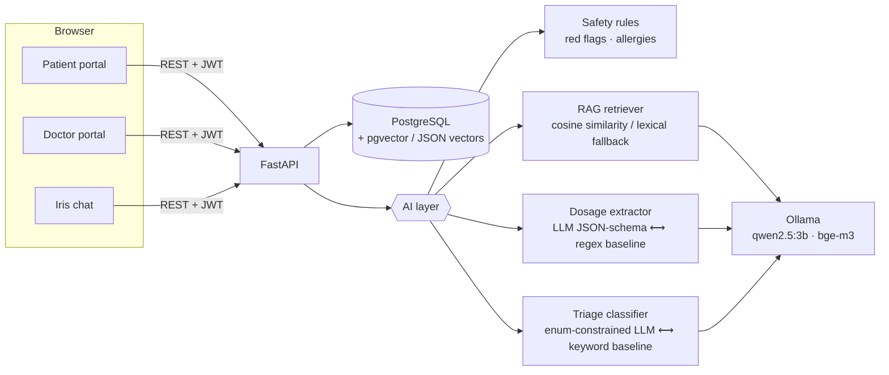

# 4Health 🩺 - Local-LLM assistant for patients and doctors

**4Health** is a medical web platform with separate **doctor** and **patient** portals and an AI assistant (**Iris**) that runs **fully locally with [Ollama](https://ollama.com)**, so no patient data leaves the machine.

Doctors write e-prescriptions, which are stored in PostgreSQL. Patients see them in their account, and Iris:

1. **explains each prescription in plain Romanian**: what each drug is for, how to take it, a suggested daily schedule, key warnings, and an **allergy check** against the patient's profile. Answers are grounded in a local drug knowledge base (RAG over PostgreSQL).
2. **answers general health questions** with retrieved sources and hard safety guardrails.
3. **recommends the right specialty and doctor** from a symptom description, with a deterministic emergency (red-flag) layer that bypasses the LLM entirely.

The project's main focus is **measuring** these components: [`api/eval/`](api/eval) contains labelled datasets, rule-based baselines and an evaluation harness that compares several local models on accuracy *and* latency on consumer hardware (GTX 1050, 4 GB VRAM).

> ⚠️ Educational project. Not a medical device. The drug knowledge base consists of hand-written educational summaries, not official leaflets.

---

## Architecture



**Prescription interpretation pipeline** (`api/app/ai/prescription.py`):

```
prescription (DB) ─► deterministic facts ─► drug matching ─► allergy check (rules, no LLM)
                                         └► dosage text ─► structured dosage (LLM / regex) ─► schedule
                     knowledge chunks (RAG) ─► LLM explanation (JSON schema, grounded) ─► post-processing
                                                                                       (doctor's original text kept verbatim)
```

Design choices worth noting:

| Choice | Why |
|---|---|
| **Structured outputs** (`format: <JSON Schema>` in Ollama) everywhere | Small models (2-4B) are unreliable at free-form JSON; schema-constrained decoding makes outputs parseable, and enums prevent hallucinated specialties. |
| **Safety layer runs before the LLM** | Emergencies ("chest pain", "can't breathe", self-harm…) get a fixed 112 message. They are never sent to a 3B model, and a test checks this. |
| **Rule-based baselines for every LLM task** | Each LLM task can be compared against a simple baseline, and the rules serve as a fallback when Ollama is down. |
| **Doctor's original instructions always shown** | The LLM rephrases and never replaces the doctor's dosage text. |
| **Pluggable vector backend** (`VECTOR_BACKEND`) | `pgvector`: cosine search in SQL. `python`: embeddings stored as JSON in plain PostgreSQL and searched exhaustively in Python, which is enough for a corpus of hundreds of chunks and needs no extensions. The test suite runs on both. |
| **Multilingual embeddings (bge-m3)** | Romanian queries; English-centric embedding models retrieve poorly. |

---

## Installation

You need four things installed. Everything else is automated.

| Requirement | Get it | Notes |
|---|---|---|
| **Python 3.11+** | [python.org/downloads](https://www.python.org/downloads/) | On Windows, tick **"Add python.exe to PATH"** in the installer. |
| **PostgreSQL 14+** | [postgresql.org/download](https://www.postgresql.org/download/) | Keep **"Command Line Tools"** selected; remember the password you set for the `postgres` user. pgAdmin and Stack Builder are not needed. No extensions required. |
| **Ollama** | [ollama.com/download](https://ollama.com/download) | Runs the AI models locally. Optional: the app works without it, minus the AI answers. |
| **Git** | [git-scm.com](https://git-scm.com/downloads) | To clone the repo. |

> 💡 Low on space on `C:`? Install PostgreSQL to another drive. For Ollama, set the user environment variable `OLLAMA_MODELS=D:\ollama\models` (and restart Ollama) **before** setup, because the models take about 3 GB.

### 1. Clone and set up (one time)

**Windows**: clone the repo, then double-click **`setup.bat`** (or run it from a terminal):

```powershell
git clone https://github.com/<your-username>/4Health.git
cd 4Health
.\setup.bat
```

**Linux / macOS**:

```bash
git clone https://github.com/<your-username>/4Health.git
cd 4Health
./setup.sh
```

The setup script:

1. checks Python, creates a virtual environment in `api/.venv` and installs [`api/requirements.txt`](api/requirements.txt);
2. creates `.env` from [`.env.example`](.env.example) with a random JWT secret;
3. creates the PostgreSQL user and databases (asks once for the `postgres` password), using [`api/scripts/setup_db.sql`](api/scripts/setup_db.sql);
4. downloads the Ollama models (`qwen2.5:3b`, `bge-m3`) if Ollama is running;
5. creates the tables, loads demo data and builds the knowledge index.

You can safely run it again: every step skips what is already done.

### 2. Start

Double-click **`start.bat`** (Windows), or run `./start.sh` (Linux/macOS). Your browser opens at **http://localhost:8000**. Stop the server with `Ctrl+C`.

The interactive API docs are at **http://localhost:8000/docs**.

### Demo accounts

All demo accounts use the password `parola123`.

| Role | Email |
|---|---|
| Patient (penicillin allergy, has an amoxicillin prescription) | `ion.popescu@4health.ro` |
| Patient | `elena.dobre@4health.ro`, `mihai.vasile@4health.ro` |
| Family doctor | `dr.andrei.ionescu@4health.ro` |
| Cardiologist | `dr.elena.georgescu@4health.ro` |

New doctor accounts need the invite code from `.env` (`DOCTOR_INVITE_CODE`, default `DOCTOR-2026`).

### Troubleshooting

| Problem | Fix |
|---|---|
| `running scripts is disabled on this system` | Use `setup.bat` / `start.bat`, which bypass the policy for these scripts only. |
| `ModuleNotFoundError: No module named ...` | You are using the system Python. Use the start scripts, or run commands with `api\.venv\Scripts\python.exe` (Linux: `api/.venv/bin/python`). |
| `connection refused` on port 5432 | The PostgreSQL service is stopped. On Windows: `services.msc` → `postgresql-x64-NN` → Start. |
| Chat header shows "Ollama oprit" / missing model | Start the Ollama app, run `ollama pull qwen2.5:3b` and `ollama pull bge-m3`, then rebuild the index: `cd api` → `.venv\Scripts\python.exe -m app.seed --rag-only`. |
| Start over with fresh demo data | `cd api` → `.venv\Scripts\python.exe -m app.seed --reset` (**deletes all data**). |

<details>
<summary><b>Manual setup (what the scripts do)</b></summary>

```powershell
psql -U postgres -h localhost -f api/scripts/setup_db.sql
copy .env.example .env
cd api
python -m venv .venv
.venv\Scripts\python.exe -m pip install --no-cache-dir -r requirements.txt
.venv\Scripts\python.exe -m app.seed
.venv\Scripts\python.exe -m uvicorn app.main:app --reload
```

**Docker alternative** (PostgreSQL with pgvector): `docker compose up -d db`, set `VECTOR_BACKEND=pgvector` in `.env`, and install `api/requirements-pgvector.txt` instead.

</details>

### Tests

```powershell
cd api
.venv\Scripts\python.exe -m pytest -q
```

The tests run against a real PostgreSQL database (`health4_test`, created by the setup) with a fake deterministic LLM, so they need no GPU. CI (GitHub Actions) runs them on every push, for both vector backends.

---

## Evaluation

```powershell
cd api
.venv\Scripts\activate      # Linux/macOS: source .venv/bin/activate
python -m eval.run_eval --task dosage    --methods rules qwen2.5:3b llama3.2:3b gemma2:2b
python -m eval.run_eval --task triage    --methods rules qwen2.5:3b llama3.2:3b gemma2:2b
python -m eval.run_eval --task retrieval
```

| Task | Dataset | Metrics |
|---|---|---|
| **Dosage extraction**: free-text Romanian posology → 8 structured fields | 30 hand-labelled instructions (`1-0-1`, `la 8 ore`, `½ cp`, PRN, …) | exact match, per-field accuracy, median latency |
| **Triage**: symptom description → 1 of 14 specialties + emergency detection | 45 cases (35 routine, 10 emergencies) | red-flag recall/precision, accuracy, macro-F1, latency |
| **Retrieval**: question → relevant knowledge chunk | 22 queries | recall@4, MRR (embedding vs lexical) |

Each run saves all predictions as JSON plus a Markdown summary in `api/eval/results/`, so errors can be inspected case by case.

### Results (GTX 1050 4 GB, 8 GB RAM)

<!-- Fill in after running the commands above. -->

| Dosage extraction | exact match | field acc. | latency |
|---|---|---|---|
| rules (baseline) | 0.90 | 0.988 | <1 ms |
| qwen2.5:3b | _TODO_ | | |
| llama3.2:3b | _TODO_ | | |

| Triage | red-flag recall | accuracy | macro-F1 | latency |
|---|---|---|---|---|
| rules (baseline) | 1.00 | 0.86 | 0.877 | <1 ms |
| qwen2.5:3b | (same rules) | _TODO_ | | |

> **Note on methodology:** the rule baselines were developed while looking at these datasets (for example, the eval revealed that *"durere **puternică** în piept"* slipped past the chest-pain regex, which was then fixed). The baseline numbers are therefore optimistic **dev-set** numbers. A fair comparison needs a held-out test set written by someone else; that is the next item on the roadmap.

---

## Project structure

```
api/
  app/
    main.py            FastAPI app, serves web/ as static files
    models.py          SQLAlchemy models (users, doctor/patient profiles, prescriptions, chat, knowledge_chunks[vector])
    routers/           auth · doctors · patients · ai
    ai/
      ollama_client.py   minimal HTTP client (chat with JSON schema, embeddings)
      safety.py          red flags, allergy check, disclaimers
      dosage.py          regex baseline + LLM extractor + schedule builder
      rag.py             ingestion, vector search (pgvector or Python), lexical fallback
      prescription.py    interpretation pipeline
      triage.py          specialty classification + doctor lookup
      chat.py            conversational assistant
    seed.py            demo data + RAG indexing
  knowledge/           drug summaries + general advice (RAG corpus)
  eval/                datasets, run_eval.py, results/
  tests/               pytest (API flow, permissions, AI units)
web/                   HTML/CSS/JS frontend (patient, doctor, chat)
setup.bat / setup.sh   one-time installation
start.bat / start.sh   start the app
docker-compose.yml     optional: PostgreSQL + pgvector (and API container)
```

## Roadmap / open research questions

- [ ] **Held-out test sets** written independently, plus inter-annotator agreement on the triage labels.
- [ ] **Faithfulness of explanations**: an LLM-as-judge or NLI check that each warning in the explanation is supported by a retrieved chunk; measure the hallucination rate per model.
- [ ] **Calibrating `RAG_MIN_SCORE`** on the retrieval set (precision/recall trade-off of the similarity threshold).
- [ ] **Quantization study**: q4_K_M vs q8_0 for the same model, measuring accuracy against VRAM and latency on a 4 GB GPU.
- [ ] **Fine-tuning** a 1-3B model (LoRA) for dosage extraction on synthetic and augmented data; compare it with prompting.
- [ ] **Official data source**: replace the hand-written drug summaries with SmPC/leaflets from the ANMDMR nomenclature; chunking experiments.
- [ ] Alembic migrations, rate limiting, audit log of AI outputs shown to patients.

## Limitations & ethics

- Iris does **not** diagnose and does **not** change doses. The doctor's text is always displayed next to the AI output.
- The red-flag rules favour recall over precision, so a false alarm costs less than a missed emergency.
- Everything runs locally. Prescriptions and chats stay in the local database and are never sent to a cloud API.
- The demo data is synthetic. CNPs are fake.

## License

MIT
